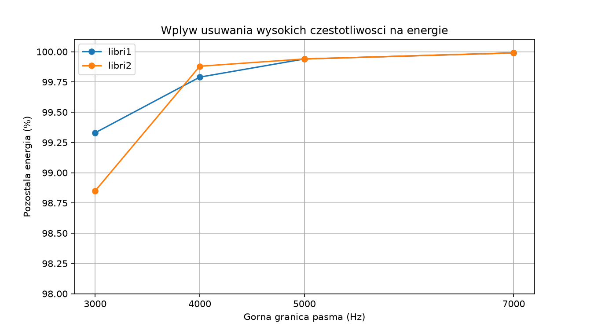

# AI Audio – analiza i filtracja mowy

## Cel projektu

Moim celem było zbadanie, jak usuwanie wybranych zakresów częstotliwości wpływa na brzmienie i zrozumiałość ludzkiej mowy.

Chciałem sprawdzić, które informacje zawarte w sygnale dźwiękowym mogę usunąć bez znaczącego pogorszenia zrozumiałości wypowiedzi.

## Wykorzystane narzędzia

W projekcie wykorzystałem:

- **Python** – do napisania programów i przeprowadzenia eksperymentów.
- **librosa** – do wczytywania nagrań oraz wykonywania transformacji STFT i odwrotnej STFT.
- **NumPy** – do operacji na tablicach i obliczania energii sygnału.
- **Matplotlib** – do tworzenia spektrogramów i wykresów.
- **SoundFile** – do zapisywania zmodyfikowanych nagrań w formacie WAV.
- **Audacity** – do odsłuchiwania i porównywania nagrań.

## Przebieg eksperymentów

Przeprowadziłem eksperymenty na dwóch nagraniach mowy z przykładowych plików LibriSpeech dostępnych w bibliotece librosa (`libri1` i `libri2`).

Najpierw wczytałem nagrania i wykonałem krótkoczasową transformatę Fouriera (STFT), aby przeanalizować ich składowe częstotliwościowe.

Następnie usuwałem wybrane składowe, zerując odpowiednie współczynniki STFT. Za pomocą odwrotnej transformacji STFT odtwarzałem zmodyfikowany dźwięk.

Podczas eksperymentów sprawdzałem:

- Jak usuwanie wysokich częstotliwości wpływa na brzmienie głosu.
- Co się stanie, gdy usunę niskie częstotliwości.
- Czy pozostawienie wyłącznie określonego pasma pozwoli mi nadal rozumieć wypowiadane słowa.
- Ile energii sygnału pozostaje po filtracji.
- Czy podobne wyniki uzyskam dla dwóch różnych nagrań.

Wyniki oceniałem poprzez analizę spektrogramów, obliczenia oraz samodzielny odsłuch nagrań w Audacity.

## Wyniki

### Usuwanie wysokich częstotliwości

Sprawdziłem, jaki procent energii pozostaje po usunięciu częstotliwości powyżej określonej granicy.

| Zachowane pasmo | libri1 | libri2 |
|---|---:|---:|
| 0–3000 Hz | 99,33% | 98,85% |
| 0–4000 Hz | 99,79% | 99,88% |
| 0–5000 Hz | 99,94% | 99,94% |
| 0–7000 Hz | 99,99% | 99,99% |

Zauważyłem, że wraz ze zwiększaniem górnej granicy pasma energia nagrania zbliżała się do energii oryginału.

Podczas odsłuchu pierwszego nagrania zauważyłem, że ograniczenie pasma do 3000 Hz powodowało stłumienie głosu i pogorszenie zrozumiałości. Z kolei wersja ograniczona do 7000 Hz brzmiała bardzo podobnie do oryginału.

### Pozostawienie pasma 500–4000 Hz

Sprawdziłem również, czy wypowiedź pozostanie zrozumiała, jeżeli usunę zarówno niskie, jak i wysokie częstotliwości.

| Nagranie | Pozostała energia | Moja obserwacja |
|---|---:|---|
| libri1 | 13,51% | Nadal rozumiałem wypowiedź |
| libri2 | 34,98% | Nadal rozumiałem wypowiedź |

W obu przypadkach udało mi się zrozumieć wypowiadane słowa, mimo znacznego zmniejszenia energii sygnału.

Zauważyłem również, że usuwanie niskich częstotliwości zmniejszało basowość głosu.

## Najważniejsze wnioski

Na podstawie przeprowadzonych eksperymentów wyciągnąłem następujące wnioski:

1. **Nie wszystkie częstotliwości mają taki sam wpływ na odbiór mowy.** Usunięcie wysokich częstotliwości może pogarszać wyrazistość głosu, natomiast usunięcie niskich częstotliwości zmienia przede wszystkim jego barwę.

2. **Duża energia sygnału nie musi oznaczać dużej ilości informacji potrzebnych do rozumienia mowy.** W pierwszym nagraniu po pozostawieniu pasma 500–4000 Hz zachowałem tylko 13,51% energii, a mimo to nadal rozumiałem wypowiedź.

3. **Ten sam filtr może dawać różne wyniki dla różnych nagrań.** Przy paśmie 500–4000 Hz uzyskałem 13,51% zachowanej energii dla pierwszego nagrania i 34,98% dla drugiego.

4. **Spektrogram pozwala analizować rozkład częstotliwości w czasie, ale nie mówi wszystkiego o odbiorze dźwięku.** Sam wygląd spektrogramu nie wystarcza, aby wiarygodnie ocenić zrozumiałość wypowiedzi.

5. **Jakość brzmienia i zrozumiałość mowy to różne rzeczy.** Nagranie może brzmieć mniej naturalnie, ale nadal pozwalać na rozpoznanie słów.

## Instalacja i uruchomienie

Projekt napisałem w Pythonie. Do uruchomienia programów potrzebne są biblioteki `librosa`, `numpy`, `matplotlib`, `soundfile` i `PyQt6`.

### 1. Przygotowanie środowiska

Po pobraniu projektu mogę utworzyć środowisko wirtualne poleceniem:

`python3 -m venv .venv`

Następnie aktywuję je w systemie Linux:

`source .venv/bin/activate`

### 2. Instalacja bibliotek

Instaluję wymagane biblioteki poleceniem:

`python -m pip install librosa numpy matplotlib soundfile PyQt6`

### 3. Uruchomienie programów

Projekt zawiera trzy główne pliki Pythona:

- **`main.py`** – wczytuje nagranie, wykonuje filtrację, oblicza energię i wyświetla spektrogramy. Pozwala mi analizować pojedynczy eksperyment.
- **`eksperymenty.py`** – automatycznie wykonuje kilka filtracji dla różnych granic częstotliwości, korzystając z przygotowanych przeze mnie funkcji.
- **`wykres.py`** – tworzy wykres porównujący wyniki pomiarów energii dla obu nagrań.

Uruchamiam je za pomocą poleceń:

`python main.py`

`python eksperymenty.py`

`python wykres.py`

Przy pierwszym uruchomieniu biblioteka librosa może potrzebować połączenia z internetem, aby pobrać przykładowe nagranie.

Programy zapisują wygenerowane nagrania i wykresy w folderze `outputs`.

## Struktura projektu

- `main.py` – analiza nagrania, filtracja i spektrogramy.
- `eksperymenty.py` – automatyczne eksperymenty z wykorzystaniem funkcji i pętli.
- `wykres.py` – wykres porównujący zachowaną energię.
- `wyniki.md` – szczegółowy opis eksperymentów i obserwacji.
- `outputs/` – wygenerowane nagrania WAV oraz wykres PNG.

## Podsumowanie

Dzięki realizacji projektu lepiej zrozumiałem, czym jest
spektrogram i jak działa transformata STFT.

Nauczyłem się analizować nagrania, usuwać wybrane
częstotliwości oraz porównywać wyniki za pomocą
obliczeń, wykresów i odsłuchu.

Najciekawszą obserwacją było dla mnie to, że
mogłem usunąć znaczną część energii nagrania,
a mimo to nadal rozumieć wypowiadane słowa.
